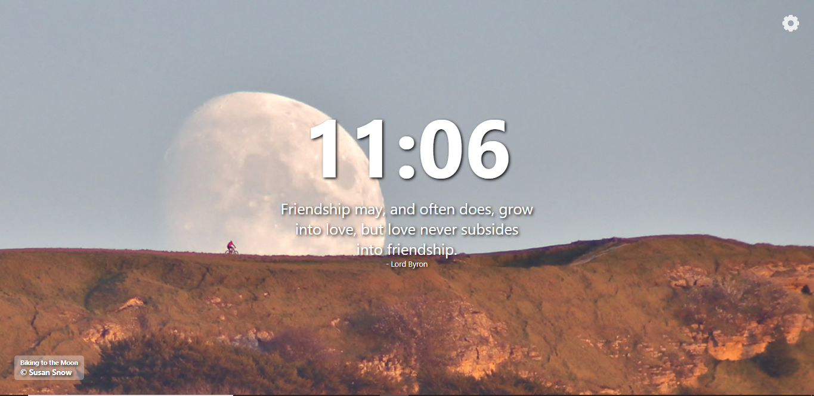

# Astrominia – New Tab Chrome Extension

Beautiful NASA Astronomy Picture of the Day images and inspiring quotes on every new tab. Works online and offline with graceful fallbacks.

## Live Preview
See how the new tab looks without installing: [Live Demo](https://astrominia.netlify.app/)

## Screenshot


## Features
- Daily background from NASA APOD (with copyright and title when available)
- Motivation via random quotes from Quotable
- Offline-friendly: shows a local curated image and last cached quote/author
- Minimal UI: time display, author/title, and a small menu
- Lightweight, no tracking

## Installation

### From the Chrome Web Store
Install the extension directly: [Chrome Web Store link](https://bit.ly/3eSqWOc)

### Manual installation (Developer mode)
1. Download or clone this repository and unzip if needed.
2. In Chrome or Edge, open the Extensions page:
   - Chrome: `chrome://extensions`
   - Edge: `edge://extensions`
3. Enable Developer mode.
4. Click "Load unpacked" and select this project folder.

## Configuration (NASA API key)
This extension uses the NASA APOD API. You need a free API key:
1. Request a key at: https://api.nasa.gov/
2. Open `Scripts/script.js` and replace the placeholder:
   ```js
   const API_KEY = "API_KEY"; // <- replace with your key
   ```

Notes:
- The key is public in the extension bundle (there is no server). Use a demo key for personal use.
- On APOD video days or if the image is unavailable, the extension falls back to a local offline image.

## Project structure
```
.
├── index.html
├── manifest.json
├── LICENSE
├── Scripts/
│   └── script.js
├── Styles/
│   └── style.css
├── icons/
└── images/
    └── offline/
```

## Tech and APIs
- NASA APOD: `https://api.nasa.gov/planetary/apod`
- Quotable: `https://api.quotable.io/random?maxLength=215`

## Privacy
- No analytics or tracking.
- Uses `localStorage` only to cache the last quote/author for offline use.
- Requests images from NASA APOD and text from Quotable over HTTPS.

## Support and feedback
- Report issues or request features: https://github.com/pikachuonacid/Astrominia-Chrome-Extension/issues/
- Buy me a coffee: https://www.buymeacoffee.com/pikachuonacid/

## Compatibility note
This repository uses Chrome Extension Manifest V2 (`manifest_version: 2`). If you plan to publish to the Chrome Web Store long‑term, consider migrating to Manifest V3.

## License
[MIT](./LICENSE)

## Credits
- Images: NASA APOD
- Quotes: Quotable
- Original author: pikachuonacid
